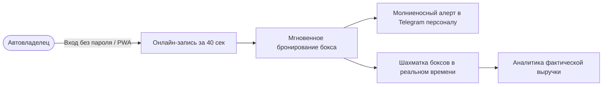
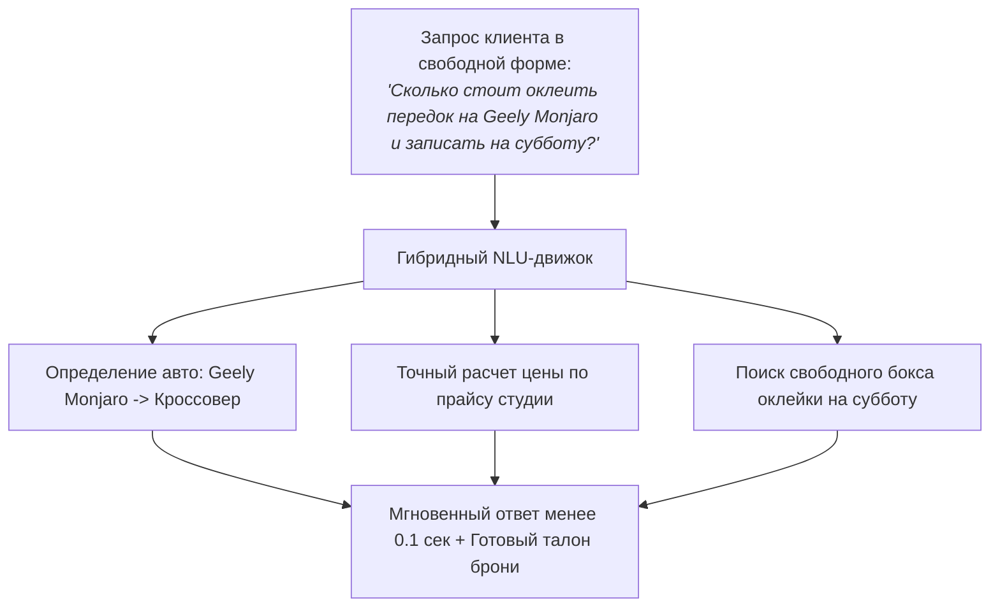
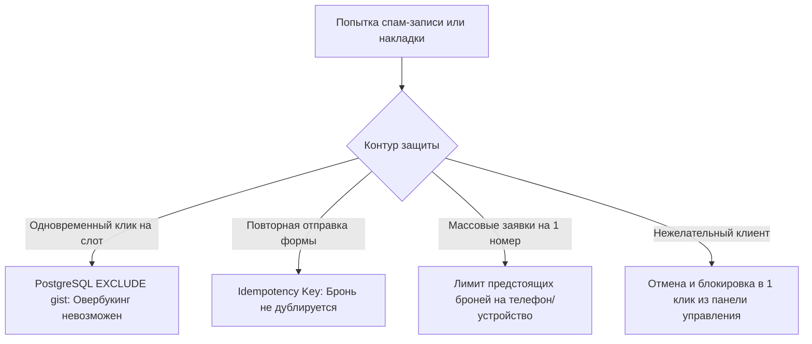

# Detailing Booking PWA — Продуктовая презентация платформы

> **Премиальная White-Label PWA-платформа онлайн-записи, управления загрузкой боксов и аналитики для детейлинг-центров, студий автостайлинга и сервисов премиум-класса.**

---

## 1. Резюме и бизнес-ценность (Executive Summary)

В сфере автодетейлинга и стайлинга средний чек варьируется от 15 000 до 250 000 рублей, а технологический цикл длится от 2 часов до 4–5 дней. Стандартные CRM-системы (YClients, DIKIDI и др.) создавались для сферы красоты и услуг «одного мастера», поэтому они критически не подходят для детейлинга:
* Они не умеют блокировать **физические боксы, зоны сушки и подъемники**;
* Они не поддерживают **многодневные неразрывные работы** («Ночное хранение» автомобиля);
* Они не пересчитывают автоматически стоимость и трудозатраты в зависимости от **класса и габаритов автомобиля**;
* Они навязывают регистрацию, отправку платных SMS и уводят клиентов в свои общие маркетплейсы конкурентов.

**Detailing Booking PWA** решает эти задачи «из коробки», предоставляя владельцу бизнеса автономный цифровой инструмент, защищающий студию от простоев и овербукинга.

---

## 2. Концепция White-Label: Ваш личный бренд без посредников

Платформа разворачивается как персональное брендированное приложение вашей студии:
* **Изолированный стиль:** Фирменная палитра, оригинальный логотип, слоган, адрес и статус «Хорошее место Яндекс 5.0»;
* **Установка на экран смартфона (PWA):** Клиенту предлагается установить приложение вашей студии в 1 клик. На домашнем экране iPhone или Android появляется полноценная иконка с вашим логотипом и официальным названием;
* **Никаких сторонних логотипов:** Клиент видит только ваш бренд — никакой рекламы других автосервисов или баннеров агрегатора.

---

## 3. Клиентский путь (Client Journey & UX)

Пользовательский интерфейс оптимизирован под привычки владельцев премиальных автомобилей: минимум текста, крупные элементы управления под большой палец и бронирование за 3–4 касания.

### 3.1. Мгновенный выбор класса автомобиля
Стоимость детейлинга напрямую зависит от размера кузова. Клиент в один тап выбирает категорию:
1. **Седан / Хэтчбек** — базовый тариф;
2. **Кроссовер** — компактные и среднеразмерные SUV (+20% к стоимости);
3. **Внедорожник / Минивэн** — полноразмерные внедорожники и бизнес-вэны (+40% к стоимости).

> Каталог моментально пересчитывает все цены, состав работ и время бронирования под выбранный автомобиль.

### 3.2. Каталог услуг и умные допродажи (Upsell)
* Четкое деление на направления: «Мойка и уход», «Защита и полиуретан (PPF)», «Полировка и керамика 9H», «Спецуслуги»;
* Прозрачные типы цен: точные фиксированные тарифы, составные работы «от» и бесплатный 30-минутный слот на диагностику и дефектовку ЛКП толщиномером;
* **Интерактивный Upsell-баннер:** Индивидуальное спецпредложение (например, нанесение гидрофобного состава на стекла со скидкой 40% при записи на восстановительную полировку) с добавлением в заказ в одно касание.

### 3.3. Мобильный мастер онлайн-записи
* **Горизонтальная лента 7 дней:** Быстрый выбор даты без утомительного листания стандартных календарей;
* **Живые слоты времени:** Отображаются только реально свободные временные интервалы с учетом рабочих часов студии и фактической занятости профильных боксов;
* **Ввод данных без барьеров:** Понятная маска телефона `+7`, автоопределение марки автомобиля и поле для особых пожеланий.

### 3.4. Беспарольный электронный талон и нативные уведомления
После подтверждения клиент сразу получает защищенный цифровой билет:
* **Вход без логина и пароля:** Доступ по персональному защищенному токену;
* **Выгрузка в системный календарь (.ics):** Добавление встречи в Apple Calendar, Google Calendar или Outlook за 1 секунду с адресом студии и встроенным будильником-напоминанием за 2 часа до визита;
* **Нативные Web Push уведомления:** Поддержка системных Push-уведомлений (активируется после добавления PWA на домашний экран iOS/Android) для информирования о статусе готовности автомобиля;
* **Web Share API:** Быстрая отправка ссылки на талон в Telegram, WhatsApp или SMS.

### 3.5. Раздел «Мои записи» и самообслуживание
Клиент всегда может открыть свои активные брони, перенести визит на другое время или отменить заказ без звонков администратору.

---

## 4. Гибридный NLU-движок с локальной базой знаний авторынка РФ

В платформу интегрирован специализированный модуль понимания естественного языка (Natural Language Understanding), адаптированный под автомобильную специфику России.

### Бизнес-преимущества для студии:
* **Мгновенный отклик (<0.1 сек):** Ответ генерируется прямо в браузере клиента без задержек и ожидания;
* **100% защита от галлюцинаций:** Движок оперирует строго заложенным прайсом вашей студии и никогда не назовет выдуманную цену или скидку;
* **Нулевая себестоимость владения:** Работает автономно, без подписок на зарубежные сервисы (OpenAI/Anthropic), без оплаты токенов и без риска внезапной блокировки;
* **База знаний автопарка РФ:** Автоматически распознает сотни марок и моделей (Camry, BMW 3/5, Tiguan, Land Cruiser, Lixiang L7/L9, Zeekr 001, Geely, Haval и др.) и переключает ценовой класс услуги на лету;
* **Запись прямо в диалоге:** Распознает фразы вроде *«запиши на субботу в 11 утра»*, автоматически резервирует слот и присылает готовый талон.

---

## 5. Кабинет управляющего и администратора (Owner & Admin Portal)

Интерфейс спроектирован для удобной работы как со смартфона администратора в рабочей зоне, так и с планшета или монитора на стойке ресепшн.

### 5.1. Интерактивная «Шахматка» загрузки боксов
* Наглядный почасовой таймлайн (день / неделя) с делением по постам: боксы детейлинга, посты мойки, подъемники;
* Отображение имени клиента, авто, телефона для быстрого звонка в 1 тап и технологического буфера;
* **Ручное бронирование:** Быстрое добавление клиента «с улицы» или по телефонному звонку;
* **Блокировка бокса:** Вывод поста из эксплуатации на время обеда, технического обслуживания или замены освещения.

### 5.2. Многодневные работы и «Ночное хранение» (Overnight Stay)
Оклейка кузова полиуретаном (PPF) или многослойные керамические комплексы требуют от 24 до 96 часов непрерывного нахождения автомобиля в студии. 
* Платформа непрерывно резервирует конкретный бокс на весь срок работ (например, со вторника 11:00 по пятницу 18:00);
* Алгоритм корректно учитывает нерабочие ночные часы студии и технологические паузы на просушку и кристаллизацию составов — бронь не разрывается и защищена от случайного подселения других машин.

### 5.3. Оперативные оповещения персонала (Telegram Alert)
Администратору и мастерам больше не нужно непрерывно обновлять экран расписания:
* При создании, переносе или отмене брони бот мгновенно отправляет информационную карточку заказа в закрытый Telegram-чат студии;
* В сообщении содержатся: имя, телефон, модель авто, выбранная услуга, сумма заказа и прямые кнопки для связи с клиентом в один клик.

### 5.4. Честная финансовая аналитика
В отличие от систем, записывающих будущие брони в доход, аналитический модуль платформы строго следует правилу фактической выручки:
* **Только реальные деньги:** В расчет попадают исключительно выполненные заказы и принятые оплаты;
* **Метрики в реальном времени:** Выручка за сегодня / неделю / месяц, количество обслуженных авто, средний чек (AOV) и процент загрузки боксов.

### 5.5. Цифровой акт приемки и фотофиксация (Roadmap v1.1)
При переводе заказа в статус «В работе» мастер может прикрепить фотографии автомобиля с фиксацией сколов, царапин и вмятин «До / После». Это исключает потребительский экстремизм и формирует открытый отчет в электронном талоне клиента.

---

## 6. Надежность и защита от злоупотреблений

1. **Защита от овербукинга на уровне базы данных:** Даже при одновременном нажатии кнопки «Записаться» несколькими клиентами на один и тот же бокс, архитектура базы физически исключает накладку времени.
2. **Защита от спама и фейковых броней (Anti-Spam & Rate Limiting):**
   - Контроль уникальности запроса (`idempotency_key`) исключает случайные дубли при нестабильном мобильном интернете;
   - Интеллектуальный лимит на количество активных предстоящих броней с одного номера телефона и цифрового отпечатка устройства;
   - Возможность моментальной отмены подозрительной брони в 1 тап из кабинета владельца.
3. **Безопасность персональных данных:** Клиентские данные и телефоны изолированы и защищены криптографическими алгоритмами хеширования.

---

## 7. Быстрый White-Label онбординг студии

Мы исключили сложный и долгий процесс ручной настройки системы:
* **Автоматический перенос профиля:** Фирменный стиль, официальный логотип, точный адрес, телефон, координаты на карте, актуальный график работы и бейджи наград автоматически импортируются напрямую из верифицированного профиля вашей студии в **Яндекс Картах** или **2ГИС**;
* **Готовая прайс-матрица:** Структура услуг адаптируется под специфику студии (оклейка, полировка, автосвет, химчистка) с готовым разделением по 3 классам автомобилей;
* **Запуск за 24 часа:** Студия получает полностью настроенную систему, готовую к приему трафика из рекламы, соцсетей и мессенджеров.

---

## 8. Интерактивный демонстрационный стенд (Live Demo / Staging)

Оцените работу платформы в реальном времени на подготовленных демонстрационных студиях:

| Студия | Специализация | Ссылка на клиентский PWA | Кабинет владельца |
| :--- | :--- | :--- | :--- |
| **Хелиос Тюнинг** | Автосвет Bi-LED, полировка, бронирование фар | [Открыть PWA](https://inyakindmitry1-wq.github.io/dete-booking/s/helios/) | [Вход в кабинет](https://inyakindmitry1-wq.github.io/dete-booking/s/helios/owner/) |
| **CarOne** | Премиальный детейлинг полного цикла, PPF пленки | [Открыть PWA](https://inyakindmitry1-wq.github.io/dete-booking/s/carone/) | [Вход в кабинет](https://inyakindmitry1-wq.github.io/dete-booking/s/carone/owner/) |
| **EV Motors** | Детейлинг и бронирование премиальных электромобилей | [Открыть PWA](https://inyakindmitry1-wq.github.io/dete-booking/s/ev-motors/) | [Вход в кабинет](https://inyakindmitry1-wq.github.io/dete-booking/s/ev-motors/owner/) |
| **Фаворит Детейлинг** | Комплексный уход и предпродажная подготовка | [Открыть PWA](https://inyakindmitry1-wq.github.io/dete-booking/s/favorit/) | [Вход в кабинет](https://inyakindmitry1-wq.github.io/dete-booking/s/favorit/owner/) |

> [!NOTE]
> **Развертывание в боевой контур (Production):**
> При запуске платформа подключается к вашему **собственному домену или поддомену** (например, `booking.your-studio.ru`) или встраивается напрямую внутрь **Telegram Mini Apps (Web App)** для бесшовной записи клиентов прямо из официального Telegram-канала или бота студии.
