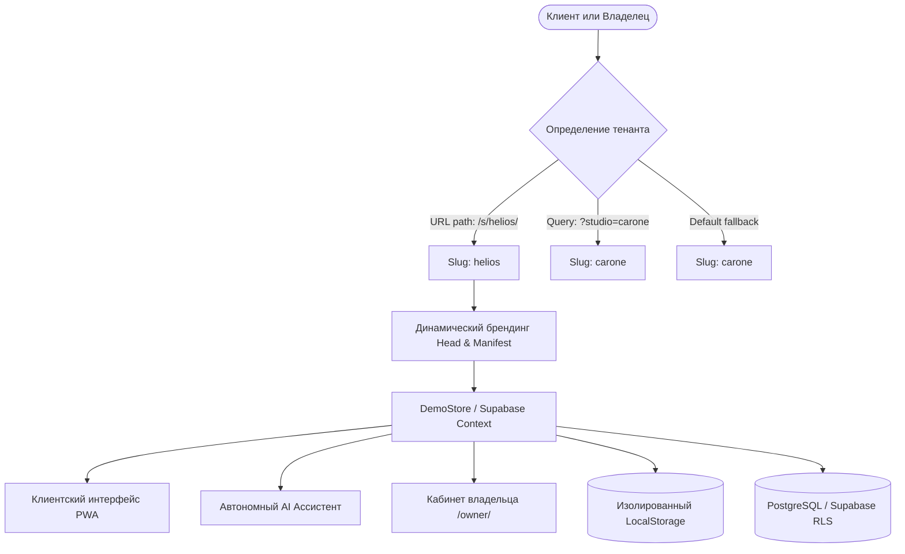
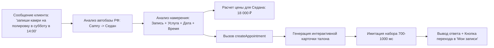
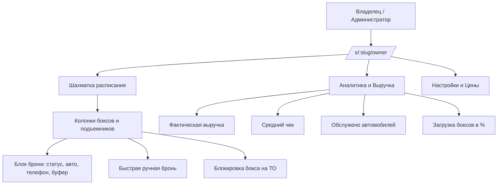
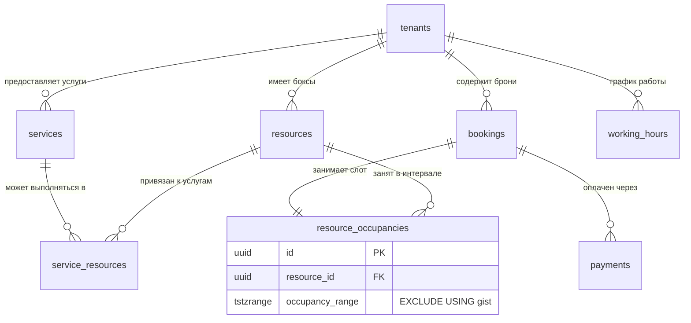

# Detailing Booking PWA — Полная документация проекта

> **Multi-tenant, White-Label Progressive Web App (PWA)** для онлайн-записи, управления загрузкой боксов и аналитики детейлинг-студий и автосервисов.

---

## 1. Резюме и назначение проекта (Executive Summary)

Проект представляет собой специализированную платформу бронирования и управления ресурсами, разработанную под специфику премиального автодетейлинга, центров оклейки, тонирования и сервисных центров.

Платформа объединяет в едином приложении два контура:
1. **Клиентский PWA-портал** (`/s/:slug/` или `?studio=:slug`) — брендированное приложение с мгновенным откликом, установкой на домашний экран смартфона без App Store/Google Play, умным выбором класса авто, динамическим расчетом цен, интерактивным выбором слотов и автономным AI-ботом.
2. **Кабинет владельца и администратора** (`/s/:slug/owner/`) — мобильная «шахматка» загрузки боксов/подъемников в реальном времени, ручное бронирование, блокировки на ТО/обеды, аналитика фактической выручки и управление услугами.

> [!IMPORTANT]
> **Ключевое отличие от универсальных CRM (YClients, DIKIDI и др.):**
> В детейлинге услуга блокирует не «мастера», а **физический ресурс** (детейлинг-бокс, подъемник, пост мойки) на непрерывный отрезок времени (от 30 минут до нескольких дней) с обязательным учетом технологического буфера на просушку/уборку. Наш движок защищает от овербукинга на уровне базы данных.

---

## 2. Архитектура и принципы Multi-Tenancy (White-Label)

Приложение построено по принципу **Single Build Multi-Tenancy**: единая кодовая база JavaScript/CSS обслуживает неограниченное количество независимых автостудий.



### Ключевые архитектурные инварианты:
* **Config-Driven White-Labeling:** Каждая студия описывается файлом пресета (`src/studios/presets/<slug>.ts`) и конфигурацией `tenants/<slug>/business.json`.
* **Zero-Drop Policy:** Публикация нового пресета или обновление настроек никогда не стирает существующие брони клиентов и историю заказов.
* **Изолированный LocalStorage:** Для демонстрационного и офлайн-режима ключи изолированы по префиксу: `detailing_demo_state_<slug>_v1` и `recent_bookings_<slug>`.
* **Динамический PWA Manifest & Head:** При загрузке страницы скрипт в `index.html` и модуль `src/studios/index.ts` моментально подставляют:
  - `<title>` с названием студии;
  - `<meta name="apple-mobile-web-app-title">` (критично для iOS, имя иконки на рабочем столе);
  - Фавиконки и `apple-touch-icon.png` конкретной студии;
  - Цвета темы (`theme-color`) под фирменный акцент.

---

## 3. Функционал клиентского PWA-портала

### 3.1. Главный экран и Hero-блок
* **Брендинг:** Логотип студии, слоган, физический адрес, телефон с быстрым вызовом, график работы.
* **Индикаторы доверия:** Официальный бейдж рейтинга Яндекс Карт (4.9–5.0), награда «Хорошее место 2026», статус открыто/закрыто.
* **Быстрое действие:** Кнопка «Записаться на осмотр» или «Подобрать услугу».

### 3.2. Переключатель классов автомобилей
Цены и время выполнения работ в детейлинге зависят от габаритов авто. В шапке каталога расположен переключатель из 3 категорий:
1. **Седан** (`class_1_sedan`) — базовый седан / хэтчбек / купе;
2. **Кроссовер** (`class_2_suv`) — компактный кроссовер (+20% к цене, округление до 500 ₽);
3. **Внедорожник** (`class_3_xl`) — рамный внедорожник / минивэн (+40% к цене, округление до 500 ₽).

Переключение мгновенно пересчитывает цены и длительности во всех карточках услуг без перезагрузки страницы.

### 3.3. Каталог услуг и допродажи (Upsell)
* **Категории:** «Все», «Мойка и уход», «Защита и пленка», «Полировка и керамика», «Спецуслуги».
* **Типы цен (`priceType`):**
  - `fixed` — точная фиксированная стоимость;
  - `from` — стоимость «от» (сложные составные работы);
  - `inspection` — диагностический слот «После осмотра» (0 ₽, длительность 30 мин для дефектовки ЛКП и замера толщины).
* **Интерактивный Upsell-баннер:** Персональное спецпредложение (например, антидождь со скидкой 40% при записи на комплекс) с добавлением в заказ в один тап.

### 3.4. Мастер записи (Booking Drawer)
Реализован на плавном выпадающем компоненте Vaul Drawer и адаптирован под мобильное управление жестами:
* **Шаг 1: Выбор даты и времени (`SlotPicker.tsx`)**
  - Горизонтальная лента 7 ближайших дней с указанием дня недели и числа;
  - Кнопка календаря для выбора любой даты на месяц вперед;
  - Горизонтальный скролл доступных временных слотов (рассчитываются алгоритмом с учетом графика работы и занятости физических боксов).
* **Шаг 2: Данные автомобиля и клиента**
  - Марка и модель (с умным автоопределением);
  - Госномер автомобиля (опционально);
  - Имя клиента и маска ввода телефона `+7 (XXX) XXX-XX-XX`;
  - Поле для пожеланий и комментариев к заказу.
* **Шаг 3: Мгновенное атомарное подтверждение**
  - Никаких ожиданий подтверждения оператором — слот резервируется сразу.

### 3.5. Электронный чек и управление бронью (`BookingReceipt.tsx`)
После записи клиент получает электронный талон:
* **Беспарольный доступ:** Запись привязана к криптографическому токену (32 байта). Клиенту не нужно регистрироваться и вспоминать пароли.
* **Экспорт в календарь (`src/lib/ics.ts`):** Генерация файла `.ics` в один клик. Событие добавляется в Apple Calendar, Google Calendar или Outlook со временем, адресом студии и напоминанием за 2 часа.
* **Поделиться талоном:** Интеграция с нативным Web Share API (отправка ссылки на бронь в Telegram, WhatsApp или SMS).
* **Push-уведомления:** Запрос разрешения на Web Push уведомления для напоминаний о визите.
* **Вкладка «Мои записи» (`MyBookingsView.tsx`):** Просмотр активных и прошедших визитов, возможность переноса времени или отмены без звонка в студию.

### 3.6. Вкладка «О студии» (`StudioInfoView.tsx`)
* Точный адрес, город, интерактивная карта с координатами;
* Прямой набор номера телефона и ссылки на мессенджеры;
* График работы по дням недели;
* Преимущества студии (гарантия, оборудование, сертифицированная химия).

---

## 4. Автономный AI-ассистент (`geminiService.ts`)

В проект встроен автономный интеллектуальный движок, работающий **локально прямо в браузере клиента**. Он не зависит от внешних API-ключей, балансов и возможных блокировок зарубежных LLM.



### Возможности AI-движка:
1. **База знаний автомобилей РФ:**
   - Распознает упоминания моделей в различных падежах и транслитерациях («камри», «бмв 3», «пятерка», «тигуан», «крузак», «гелик», «веста», «zeekr 001», «li l9» и др.);
   - Автоматически меняет выбранный класс автомобиля в контексте всего приложения (`setSelectedCar`), подгоняя цены под модель клиента;
   - Защищен от галлюцинаций: не подставляет сторонние марки («BMW 3»), если клиент просто выбрал базовый седан.
2. **Консультации по прайсу и услугам:**
   - Отвечает актуальными ценами для текущего автомобиля;
   - Подробно объясняет разницу между восстановительной и мягкой полировкой;
   - Рассказывает о нанокерамике 9H, слоях, гидрофобном эффекте и регламенте ухода;
   - Консультирует по защите полиуретановой бронепленкой (PPF) ударной зоны или всего кузова;
   - Предлагает запись на бесплатный осмотр и замер ЛКП толщиномером.
3. **Автоматическая запись в диалоге:**
   - Распознает дату («сегодня», «завтра», «в эту субботу», «15 мая») и время («в 14:00», «утром», «вечером»);
   - Вызывает метод `createAppointment` и формирует официальный талон бронирования прямо внутри чата;
   - Добавляет кликабельные кнопки быстрых ответов (`suggestedPrompts`).
4. **Имитация естественного поведения:**
   - Задержка ответа (700–1000 мс) с индикацией «Ассистент печатает...» для ощущения живого диалога.

---

## 5. Кабинет владельца студии (Owner Portal — `/s/:slug/owner/`)

Кабинет спроектирован для работы как со смартфона администратора, так и с планшета/ПК на стойке ресепшн.



### 5.1. Интерактивная «Шахматка» (`ScheduleView.tsx`)
* **Таймлайн по ресурсам:** Отображение боксов детейлинга, постов мойки и подъемников в виде параллельных колонок;
* **Режимы отображения:** День (детальный почасовой вид с шагом 30 мин) и Неделя;
* **Карточки броней:** Имя клиента, номер телефона (с возможностью звонка в один клик), марка и госномер авто, название услуги и сумма;
* **Технологические буферы:** Наглядное выделение буферного времени между машинами;
* **Ручные действия:**
  - `+ Запись` — добавление брони для клиента с улицы или по телефону (`ManualBookingDrawer.tsx`);
  - `Блокировка` — закрытие бокса на перерыв, ремонт освещения или обслуживание (`ManualBlockDrawer.tsx`);
  - Детали брони: смена статуса (`confirmed` -> `in_progress` -> `completed` / `cancelled`).

### 5.2. Достоверная аналитика (`AnalyticsView.tsx`)
Разработана в строгом соответствии с финансовыми стандартами:
* **Принцип факта выручки:** Будущие предварительные записи **никогда не считаются доходом**. В выручку идут только выполненные заказы (`completed`) или принятые платежи (`payments`).
* **Метрики за Сегодня / Неделю / Месяц:**
  - Общая выручка (₽);
  - Количество заехавших автомобилей;
  - Средний чек (AOV);
  - Процент загрузки рабочего времени боксов.

### 5.3. Настройки и профиль студии (`SettingsView.tsx`)
* Просмотр реквизитов студии, часового пояса и фирменного акцентного цвета;
* Индикатор режима: `Preview (Демо)` или `Live (Боевой)`.

---

## 6. База данных и транзакционная надежность (PostgreSQL / Supabase)

Архитектура базы данных ориентирована на максимальную отказоустойчивость при одновременных попытках бронирования одного и того же слота.



### 6.1. Защита от овербукинга на уровне ядра СУБД
В таблице `resource_occupancies` используется расширение `btree_gist` и ограничение исключения PostgreSQL:
```sql
CONSTRAINT uq_no_overlapping_occupancy 
EXCLUDE USING gist (
  resource_id WITH =,
  tstzrange(start_time, end_time, '[)') WITH &&
)
```
> [!NOTE]
> Это гарантирует, что даже при одновременных запросах от 100 клиентов в одну миллисекунду на один и тот же бокс, база физически пропустит ровно одну транзакцию, а остальные корректно обработает без порчи данных.

### 6.2. Атомарные функции
Все операции бронирования, переноса и отмены инкапсулированы в хранимые функции PostgreSQL:
* `create_booking_atomic(...)` — проверяет тенанта, идемпотентность (`idempotency_key`), находит свободный бокс, создает клиента, бронь и запись занятости в единой транзакции;
* `reschedule_booking_atomic(...)` — переносит бронь на новый слот. Если новый слот уже занят, транзакция откатывается, **сохраняя исходное время бронирования** без потери слота клиентом;
* `cancel_booking_atomic(...)` — освобождает занятость ресурса и логирует причину отмены.

### 6.3. Безопасность и RLS (Row Level Security)
* **Анонимные клиенты:** Не имеют прямого доступа к таблице клиентов (`customers`), платежам (`payments`) и персональным данным. Доступ к конкретной брони осуществляется исключительно через проверку SHA-256 хеша токена (`access_token_hash`).
* **Владельцы:** Доступ авторизуется через Supabase Auth и таблицу `tenant_members`. Владелец студии А не может увидеть брони или выручку студии Б.

---

## 7. Реестр студий-пресетов

В кодовой базе уже настроены и доступны следующие студии:

| Slug | Название студии | Город / Адрес | Специализация и фишки | Акцентный цвет |
| :--- | :--- | :--- | :--- | :--- |
| `helios` | **Хелиос Тюнинг** | Самара, ул. Стара-Загора, 42 | Профессиональный автосвет (Bi-LED модули), полировка, бронирование фар PPF, антихром | `#dc2626` (Scarlet) |
| `carone` | **CarOne** | Самара, ул. Мичурина, 21А | Премиум детейлинг полного цикла, оклейка пленками, керамика 9H | `#2563eb` (Royal Blue) |
| `ev-motors` | **EV Motors** | Самара, Московское шоссе | Уход за электромобилями, премиум защита кузова | `#2563eb` (Electric Blue) |
| `favorit` | **Фаворит Детейлинг** | Самара, 18-й км Московского ш. | Детейлинг-мойки, предпродажная подготовка, полировка | `#2563eb` (Classic Blue) |
| `brooklands` | **Brooklands** | Москва | Премиальный клубный детейлинг | `#2563eb` (Deep Navy) |
| `apex` | **Apex Detailing** | Москва | Студия спортивного детейлинга | `#f59e0b` (Amber Gold) |
| `syndicate` | **Syndicate Detailing**| Санкт-Петербург | Оклейка полиуретаном, защита премиум авто | `#10b981` (Emerald) |

### Автоматический конвейер создания студий (`GEMINI.md`)
Система поддерживает полуавтоматическое создание нового тенанта за 2–3 минуты по ссылке из Яндекс Карт или 2ГИС:
1. Извлечение названия, адреса, телефона, координат, графика работы и наград;
2. Обработка **реального официального логотипа** в 512×512 PNG с адаптацией под PWA;
3. Формирование прайс-матрицы по 3 классам авто с обязательной услугой осмотра (0 ₽);
4. Регистрация в реестре тенантов, скриптах деплоя и тестах.

---

## 8. Технологический стек

```
Frontend:
  ├── React 19 (React DOM 19)
  ├── TypeScript 5.8
  ├── Vite 6 (быстрая сборка, Hot Module Replacement)
  ├── Tailwind CSS 3.4 (утилитарные стили)
  ├── Astryx Design Core & Theme Neutral v0.6.7
  ├── Radix UI (доступные примитивы: Dialog, Tabs, Dropdown)
  ├── Vaul (плавные мобильные модальные окна Drawer)
  ├── Lucide React (иконки интерфейса)
  ├── Date-fns v4 (работа с датами и локалями)
  └── TanStack React Query v5 (кэширование серверного состояния)

PWA & Offline:
  ├── Vite Plugin PWA v0.21 (Service Worker, манифест)
  ├── Dynamic Head / WebApp Title Injector
  ├── Web Crypto API (генерация токенов, SHA-256)
  └── Offline Rule-Based AI Engine (автономный чат-бот без API ключей)

Backend & Database:
  ├── Supabase JS SDK v2
  ├── PostgreSQL 15+ с расширениями uuid-ossp, pgcrypto, btree_gist
  ├── Row Level Security (RLS)
  └── PostgreSQL Stored Procedures & Atomic Functions

Testing & Quality:
  ├── Vitest v3 (модульное тестирование)
  └── Playwright v1.51 (E2E тестирование сценариев записи)
```

---

## 9. Развертывание и CI/CD

Проект полностью настроен для непрерывной доставки на **GitHub Pages** с генерацией статических маршрутов под каждого тенанта.

### Скрипт развертывания (`scripts/deploy-gh-pages.mjs`)
* Собирает продакшн-бандл с базовым путем `/dete-booking/`;
* Автоматически создает статические директории для всех тенантов:
  - `/s/carone/index.html` + `/s/carone/manifest.webmanifest`
  - `/s/helios/index.html` + `/s/helios/manifest.webmanifest`
  - `/s/ev-motors/index.html` + `/s/ev-motors/manifest.webmanifest`
  - и аналогично для `/owner/`;
* Каждый статический HTML содержит персональные теги `<title>` и `<meta name="apple-mobile-web-app-title">` соответствующей студии, поэтому страница отдает статус **200 OK** без белых вспышек и задержек SPA-роутера;
* Пушит сборку напрямую в ветку `gh-pages` через GitHub CLI Token.

### Полезные команды проекта:
```bash
# Запуск локального сервера разработки
npm run dev

# Прогон юнит-тестов (13 тестов: слоты, крипто, AI-движок, ics, аналитика)
npm test

# Проверка типов TypeScript
npm run typecheck

# Полная сборка проекта
npm run build

# Деплой актуальной версии на GitHub Pages
node scripts/deploy-gh-pages.mjs
```

---

## 10. Доступные ссылки проекта

* **GitHub Pages (Боевой хостинг):**
  - Главная (CarOne): https://inyakindmitry1-wq.github.io/dete-booking/
  - Хелиос Тюнинг: https://inyakindmitry1-wq.github.io/dete-booking/s/helios/
  - EV Motors: https://inyakindmitry1-wq.github.io/dete-booking/s/ev-motors/
  - Фаворит Детейлинг: https://inyakindmitry1-wq.github.io/dete-booking/s/favorit/
  - Кабинет владельца (CarOne): https://inyakindmitry1-wq.github.io/dete-booking/s/carone/owner/
  - Кабинет владельца (Хелиос): https://inyakindmitry1-wq.github.io/dete-booking/s/helios/owner/

* **Локальная разработка:**
  - Клиентский портал: `http://localhost:5173/?studio=helios`
  - Кабинет владельца: `http://localhost:5173/s/helios/owner/`
