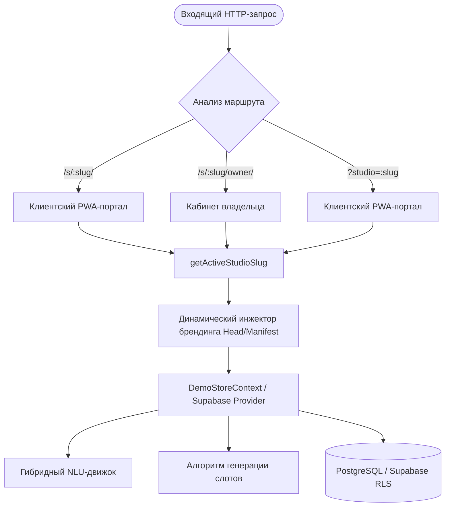
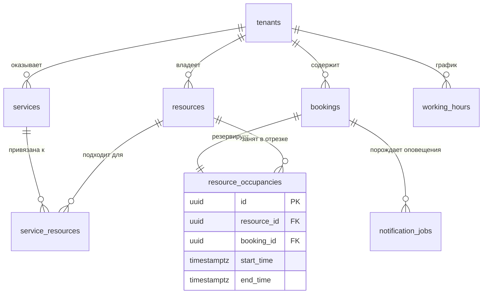
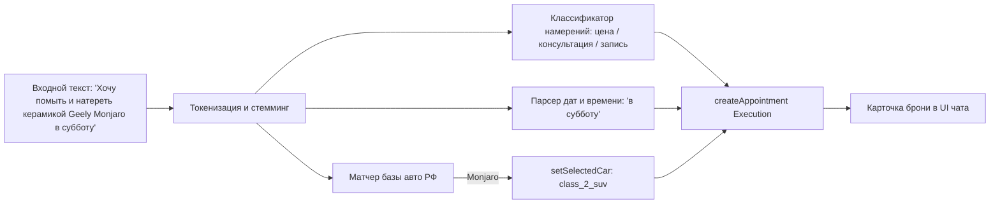

# Detailing Booking PWA — Архитектурная и техническая документация

> **Single-Build Multi-Tenant Progressive Web App (PWA)** с транзакционным ядром на PostgreSQL, алгоритмом непрерывной занятости боксов (Continuous Resource Occupancy), встроенным NLU-модулем авторынка РФ и динамическим White-Label брендингом.

---

## 1. Архитектура системы и Multi-Tenancy

Платформа спроектирована по модели **Single Build Multi-Tenancy**: единый клиентский бандл (JavaScript/CSS) и единый экземпляр базы данных Supabase (PostgreSQL) обслуживают произвольное количество независимых автостудий (тенантов).



### Основные инварианты архитектуры:
1. **Маршрутизация:**
   - Клиентский интерфейс: `/s/:slug/` (или fallback `/?studio=:slug`);
   - Кабинет владельца/администратора: `/s/:slug/owner/`;
   - Прямой просмотр талона брони: `/s/:slug/booking/:id?token=:token`.
2. **Динамический White-Label брендинг (Zero Flash):**
   - Ранний скрипт в [`index.html`](file:///c:/Users/inyak/Desktop/deteiling/index.html) и модуль [`src/studios/index.ts`](file:///c:/Users/inyak/Desktop/deteiling/src/studios/index.ts) инжектируют название студии, `<meta name="apple-mobile-web-app-title">`, фавиконки, цвета темы (`theme-color`) и манифест еще до монтирования React-дерева, предотвращая мерцание чужого бренда.
3. **Изоляция локального состояния:**
   - Каждая студия хранит свое демонстрационное состояние и историю броней в изолированных ключах `localStorage`: `detailing_demo_state_<slug>_v1` и `recent_bookings_<slug>`.
4. **Zero-Drop гарантия:**
   - Перепубликация настроек тенанта или добавление новых услуг в [`tenants/<slug>/business.json`](file:///c:/Users/inyak/Desktop/deteiling/tenants/carone/business.json) никогда не удаляет существующие брони, занятость боксов и историю клиентов в базе данных.

---

## 2. Технологический стек

### Frontend & UI
* **React 19** (`react`, `react-dom` v19.0.0);
* **TypeScript 5.8** со строгой типизацией;
* **Vite 6** (`vite` v6.2.1) — сверхбыстрая сборка и HMR;
* **Tailwind CSS 3.4** + `postcss` + `autoprefixer`;
* **Astryx Design Core** (`@astryxdesign/core`, `@astryxdesign/theme-neutral` v0.6.7) — компонентный дизайн-фреймворк;
* **Radix UI** — доступные примитивы (`@radix-ui/react-dialog`, `tabs`, `slot`, `label`);
* **Vaul** (`vaul` v1.1.2) — мобильные модальные шторки (Drawer) с поддержкой свайпов;
* **Lucide React** (`lucide-react` v1.16.0) — иконки интерфейса;
* **Date-fns 4** (`date-fns` v4.1.0) с русской локалью (`ru`) для работы с временными интервалами;
* **TanStack React Query 5** (`@tanstack/react-query` v5.67.1) — серверный стейт и кэширование.

### PWA & Офлайн-стек
* **Vite Plugin PWA** (`vite-plugin-pwa` v0.21.1) с кастомным Service Worker [`src/sw.ts`](file:///c:/Users/inyak/Desktop/deteiling/src/sw.ts);
* **Web Crypto API** — криптографическая генерация 32-байтных токенов и расчет хешей SHA-256;
* **Dynamic Web App Manifest** — генерация манифеста на лету под выбранный slug.

### Backend & База данных
* **Supabase JS SDK v2** (`@supabase/supabase-js` v2.49.1);
* **PostgreSQL 15+** с расширениями `uuid-ossp`, `pgcrypto`, `btree_gist`;
* **Хранимые процедуры (PL/pgSQL)** для атомарных операций бронирования;
* **Row Level Security (RLS)** для разграничения прав доступа.

### Тестирование и качество кода
* **Vitest 3** (`vitest` v3.0.8) — модульное тестирование (13/13 unit-тестов);
* **Playwright** (`@playwright/test` v1.51.0) — сквозные E2E тесты пользовательских сценариев.

---

## 3. Структура проекта и карта исходного кода

```
deteiling/
├── index.html                           # Точка входа, динамический Early Head Script
├── vite.config.ts                       # Конфигурация Vite и PWA Service Worker
├── src/
│   ├── main.tsx                         # Инициализация React 19, Astryx CSS стили
│   ├── App.tsx                          # Маршрутизатор (Client, Owner, Status, 404)
│   ├── sw.ts                            # Кастомный Service Worker PWA
│   ├── components/
│   │   ├── client/                      # Компоненты клиентского портала
│   │   │   ├── Home.tsx                 # Главная страница клиента
│   │   │   ├── BookingDrawer.tsx        # Пошаговая мобильная шторка бронирования
│   │   │   ├── SlotPicker.tsx           # Горизонтальный календарь и выбор времени
│   │   │   ├── VehicleTypeSelector.tsx  # Выбор класса авто (Седан, Кроссовер, SUV)
│   │   │   ├── ServiceCard.tsx          # Карточка услуги с ценой и длительностью
│   │   │   ├── BookingReceipt.tsx       # Электронный талон, .ics, Web Share
│   │   │   ├── MyBookingsView.tsx       # Вкладка «Мои записи» и управление
│   │   │   ├── StudioInfoView.tsx       # Вкладка «О студии», карта, контакты
│   │   │   ├── AIChatWidget.tsx         # Виджет умного NLU-чата
│   │   │   └── PWAInstallPrompt.tsx     # Баннер установки на домашний экран
│   │   ├── owner/                       # Компоненты кабинета владельца
│   │   │   ├── ScheduleView.tsx         # Шахматка загрузки боксов (Day/Week)
│   │   │   ├── ManualBookingDrawer.tsx  # Ручное добавление брони по звонку
│   │   │   ├── ManualBlockDrawer.tsx    # Блокировка бокса на ТО/обед
│   │   │   ├── BookingDetailsDrawer.tsx # Детали брони и смена статусов
│   │   │   ├── AnalyticsView.tsx        # Финансовая аналитика факта выручки
│   │   │   └── SettingsView.tsx         # Настройки студии, график, реквизиты
│   │   └── ui/                          # Базовые UI-примитивы (Astryx, Radix)
│   ├── services/
│   │   └── geminiService.ts             # Гибридный NLU-движок и база авторынка РФ
│   ├── lib/
│   │   ├── slots.ts                     # Алгоритм расчета свободных слотов
│   │   ├── crypto.ts                    # Безопасные токены SHA-256
│   │   ├── ics.ts                       # Генератор файлов календаря .ics
│   │   ├── pricing.ts                   # Расчет цен по 3 классам автомобилей
│   │   ├── db-mock.ts                   # Изолированный Mock DB для офлайн-режима
│   │   └── api.ts                       # Клиентский слой данных (Supabase/Mock)
│   ├── context/
│   │   └── DemoStoreContext.tsx         # Реактивное состояние студии и броней
│   ├── studios/                         # Реестр пресетов студий
│   │   ├── index.ts                     # Регистрация, брендинг, резолвер слагов
│   │   ├── types.ts                     # Типы данных студий, услуг, ресурсов
│   │   └── presets/                     # Готовые конфигурации студий (helios, carone...)
│   └── types/
│       └── database.ts                  # Схемы таблиц и RPC функций БД
├── tenants/                             # Файлы business.json для каждого тенанта
├── supabase/
│   └── migrations/                      # Миграции PostgreSQL (схемы, btree_gist, RPC)
├── scripts/
│   ├── deploy-gh-pages.mjs              # Деплой на GitHub Pages с прегенерацией статики
│   ├── tenant-validate.ts               # Валидация JSON схем тенантов
│   └── tenant-publish.ts                # Публикация тенанта в Supabase
└── tests/
    ├── unit/                            # Юнит-тесты Vitest (13 тестов)
    └── e2e/                             # Playwright тесты сценариев записи
```

---

## 4. Модель данных и транзакционное ядро (PostgreSQL)

База данных построена вокруг концепции **непрерывной занятости физических ресурсов** (`resource_occupancies`).



### 4.1. Аппаратная защита от овербукинга (`btree_gist`)
В детейлинге невозможно забронировать два автомобиля в один и тот же бокс одновременно. Это гарантируется расширением `btree_gist` и ограничением исключения:
```sql
ALTER TABLE resource_occupancies
ADD CONSTRAINT uq_no_overlapping_occupancy
EXCLUDE USING gist (
  resource_id WITH =,
  tstzrange(start_time, end_time, '[)') WITH &&
);
```
> При любых конкурентных запросах ядро PostgreSQL физически отвергает пересекающиеся диапазоны времени на одном ресурсе с кодом ошибки `23P01 (exclusion_violation)`.

### 4.2. Многодневные работы и «Ночное хранение» (Overnight Stay)
Для услуг длительностью более 1 рабочего дня (полная оклейка кузова полиуретаном PPF, многослойная нанокерамика, шумоизоляция):
* Запись резервирует непрерывный интервал в `resource_occupancies` (например, `2026-11-10 10:00:00+03` по `2026-11-13 18:00:00+03`);
* Автомобиль непрерывно занимает бокс в течение нерабочих ночных часов и технологических пауз на сушку/полимеризацию;
* Алгоритм генератора слотов ([`src/lib/slots.ts`](file:///c:/Users/inyak/Desktop/deteiling/src/lib/slots.ts)) проверяет весь непрерывный диапазон с учетом графика работы и исключений, предотвращая ошибочное подселение других авто.

### 4.3. Атомарные хранимые функции (PL/pgSQL)
Все ключевые бизнес-операции выполняются внутри неделимых транзакций на стороне СУБД ([`supabase/migrations/20261010000001_atomic_functions.sql`](file:///c:/Users/inyak/Desktop/deteiling/supabase/migrations/20261010000001_atomic_functions.sql)):
* [`create_booking_atomic`](file:///c:/Users/inyak/Desktop/deteiling/supabase/migrations/20261010000001_atomic_functions.sql#L9-L140) — проверка тенанта, поиск подходящего бокса из `service_resources`, создание брони, блокировка слота и постановка оповещения в очередь Outbox;
* [`reschedule_booking_atomic`](file:///c:/Users/inyak/Desktop/deteiling/supabase/migrations/20261010000001_atomic_functions.sql#L145-L250) — безопасный перенос записи. В случае занятости нового слота транзакция откатывается: **клиент никогда не теряет исходное забронированное время** при неудачном переносе;
* [`cancel_booking_atomic`](file:///c:/Users/inyak/Desktop/deteiling/supabase/migrations/20261010000001_atomic_functions.sql#L255-L310) — удаление записи занятости ресурса и обновление статуса на `cancelled`.

### 4.4. Защита от спама и Rate Limiting (Anti-Spam)
Так как клиентская запись работает без принудительной авторизации:
1. **Идемпотентность (`idempotency_key`):** Каждый запрос на бронирование сопровождается уникальным ключом клиента. Повторный клик или сбой связи возвращает уже созданную бронь без дублирования в БД;
2. **Лимит предстоящих броней:** Функция `create_booking_atomic` проверяет лимит активных предстоящих записей на один номер телефона (по умолчанию не более 3 активных броней);
3. **Отмена и блокировка в 1 клик:** В кабинете администратора предусмотрена возможность мгновенной отмены и блокировки недобросовестного номера.

### 4.5. Безопасность и Row Level Security (RLS)
* **Анонимные клиенты (anon):** Доступ к чтению каталога услуг и ресурсов открыт только в рамках конкретного `tenant_id`. Чтение брони разрешено только по SHA-256 хешу переданного токена (`access_token_hash`);
* **Сотрудники студии (authenticated):** Проверяются через промежуточную таблицу `tenant_members`. Доступ к финансовой аналитике и расписанию строго изолирован внутри своего тенанта.

---

## 5. Ключевые компоненты платформы

### 5.1. Алгоритм расчета свободных слотов ([`src/lib/slots.ts`](file:///c:/Users/inyak/Desktop/deteiling/src/lib/slots.ts))
Функция `calculateAvailableSlots` принимает на вход:
* Дату визита (`YYYY-MM-DD`);
* Длительность услуги + буферное время (`durationMinutes + bufferMinutes`);
* Список пригодных ресурсов (`eligibleResourceIds`);
* График работы по дням недели (`workingHours`) и праздничные исключения (`exceptions`);
* Массив существующих занятостей (`existingOccupancies`).

Алгоритм выполняет скользящую проверку с шагом 30 минут, учитывая время открытия и закрытия студии, и возвращает только гарантированно свободные слоты с указанием конкретного назначенного бокса.

### 5.2. Мобильный мастер записи ([`BookingDrawer.tsx`](file:///c:/Users/inyak/Desktop/deteiling/src/components/client/BookingDrawer.tsx))
* Реализован на базе компонента `Drawer` (Vaul) с оптимизацией под сенсорный ввод;
* Управляет шагами:
  - Шаг 0: Выбор услуги (если шторка открыта из быстрого действия);
  - Шаг 1: Горизонтальный календарь и выбор времени ([`SlotPicker.tsx`](file:///c:/Users/inyak/Desktop/deteiling/src/components/client/SlotPicker.tsx));
  - Шаг 2: Ввод данных автомобиля, имени, телефона `+7` и комментариев;
  - Шаг 3: Переход на экран талона ([`BookingReceipt.tsx`](file:///c:/Users/inyak/Desktop/deteiling/src/components/client/BookingReceipt.tsx)).

### 5.3. Электронный талон и календарь ([`BookingReceipt.tsx`](file:///c:/Users/inyak/Desktop/deteiling/src/components/client/BookingReceipt.tsx))
* Доступен по криптографической ссылке вида `/s/:slug/booking/:id?token=:token`;
* Генерирует файл календаря `.ics` ([`src/lib/ics.ts`](file:///c:/Users/inyak/Desktop/deteiling/src/lib/ics.ts)) по стандарту RFC 5545 с поддержкой таймзоны студии, адреса и встроенного будильника (`VALARM` за 2 часа);
* Интегрирован с нативным Web Share API (`navigator.share`) и системными Web Push уведомлениями.

### 5.4. Шахматка расписания ([`ScheduleView.tsx`](file:///c:/Users/inyak/Desktop/deteiling/src/components/owner/ScheduleView.tsx))
* Рендерит боксы и подъемники в виде параллельных вертикальных дорожек;
* Наглядно разделяет рабочее время услуги и буферный интервал на сушку/уборку;
* Поддерживает быстрое ручное бронирование ([`ManualBookingDrawer.tsx`](file:///c:/Users/inyak/Desktop/deteiling/src/components/owner/ManualBookingDrawer.tsx)) и блокировку бокса на ТО ([`ManualBlockDrawer.tsx`](file:///c:/Users/inyak/Desktop/deteiling/src/components/owner/ManualBlockDrawer.tsx)).

### 5.5. Оперативные оповещения персонала (Telegram Alert)
При успешном создании, переносе или отмене записи транзакция создает запись в таблице `notification_jobs`. Фоновый воркер (Supabase Edge Function / Webhook) формирует сообщение в закрытый рабочий Telegram-чат студии:
* Карточка брони: имя, телефон, автомобиль, состав услуг, сумма;
* Инлайн-кнопки для быстрого звонка или перехода в WhatsApp/Telegram клиента.

### 5.6. Цифровой акт приемки и фотофиксация (Roadmap v1.1)
В компонент деталей брони ([`BookingDetailsDrawer.tsx`](file:///c:/Users/inyak/Desktop/deteiling/src/components/owner/BookingDetailsDrawer.tsx)) заложена возможность загрузки фото состояния ЛКП при заезде и выезде автомобиля для защиты студии от претензий по доремонтным дефектам.

---

## 6. Гибридный NLU-модуль ([`src/services/geminiService.ts`](file:///c:/Users/inyak/Desktop/deteiling/src/services/geminiService.ts))

Встроенный NLU-движок обеспечивает интеллектуальное взаимодействие с клиентом прямо в браузере:



* **База авторынка РФ (`CAR_DATABASE`):** Включает популярные седаны, кроссоверы и внедорожники (Toyota, BMW, Mercedes, VAG, Geely, Haval, Chery, Zeekr, Li Auto) с автоматической категоризацией на 3 ценовых класса;
* **Регулярный парсер дат:** Распознает дни недели, относительные даты («сегодня», «завтра») и время визита;
* **Нулевая задержка и 100% точность:** Вычисления выполняются локально за <0.1 сек, исключая галлюцинации по стоимости.

---

## 7. Реестр студий и White-Label конфигурация

Каждая студия описывается JSON-структурой в каталоге `tenants/<slug>/business.json` и пресетом TypeScript в `src/studios/presets/<slug>.ts`:

```typescript
export interface StudioPreset {
  slug: string;
  name: string;
  shortName: string;
  tagline: string;
  city: string;
  address: string;
  phone: string;
  workingHoursText: string;
  coordinates: { lat: number; lng: number };
  rating: { score: number; reviewsCount: number; awardText?: string };
  branding: {
    accentColor: string;
    logoUrl: string;
    coverUrl: string;
  };
  resources: ResourceItem[];
  services: ServiceItem[];
  upsellOffer: UpsellOffer;
}
```

### Подключенные студии:
1. `helios` — **Хелиос Тюнинг** (Самара, ул. Стара-Загора, 42) — автосвет Bi-LED, полировка, антихром;
2. `carone` — **CarOne** (Самара, ул. Мичурина, 21А) — премиум детейлинг, PPF пленки;
3. `ev-motors` — **EV Motors** (Самара, Московское шоссе) — уход за электромобилями;
4. `favorit` — **Фаворит Детейлинг** (Самара, 18-й км Московского ш.) — комплексный уход;
5. `brooklands` — **Brooklands** (Москва) — элитный клубный детейлинг;
6. `apex` — **Apex Detailing** (Москва) — автостайлинг;
7. `syndicate` — **Syndicate Detailing** (Санкт-Петербург) — защита кузова.

---

## 8. Развертывание, CI/CD и статическая прегенерация

### Скрипт развертывания ([`scripts/deploy-gh-pages.mjs`](file:///c:/Users/inyak/Desktop/deteiling/scripts/deploy-gh-pages.mjs))
GitHub Pages не поддерживает нативную перезапись SPA-маршрутов на уровне сервера (URL Rewrite). Чтобы предотвратить 404 ошибки и мерцание чужого брендинга:
1. Скрипт компилирует клиентский бандл с `base: '/dete-booking/'`;
2. Для каждого тенанта и каждого маршрута (`/s/:slug/`, `/s/:slug/owner/`) генерируется физическая директория со своим статическим `index.html` и персональным `manifest.webmanifest`;
3. Каждый сгенерированный HTML содержит корректные мета-теги `<title>`, `<meta name="apple-mobile-web-app-title">` и ссылки на иконки конкретной студии, отдавая статус **200 OK**;
4. Сборка автоматически коммитится и пушится в ветку `gh-pages` через токен GitHub CLI (`gh auth token`).

### Стенды и ссылки:
* **Интерактивный демонстрационный стенд (Live Demo / Staging):**
  - Главная витрина: [https://inyakindmitry1-wq.github.io/dete-booking/](https://inyakindmitry1-wq.github.io/dete-booking/)
  - Хелиос Тюнинг: [https://inyakindmitry1-wq.github.io/dete-booking/s/helios/](https://inyakindmitry1-wq.github.io/dete-booking/s/helios/)
  - Кабинет владельца (Хелиос): [https://inyakindmitry1-wq.github.io/dete-booking/s/helios/owner/](https://inyakindmitry1-wq.github.io/dete-booking/s/helios/owner/)
  - CarOne: [https://inyakindmitry1-wq.github.io/dete-booking/s/carone/](https://inyakindmitry1-wq.github.io/dete-booking/s/carone/)
  - EV Motors: [https://inyakindmitry1-wq.github.io/dete-booking/s/ev-motors/](https://inyakindmitry1-wq.github.io/dete-booking/s/ev-motors/)
* **Боевой запуск (Production):**
  - Развертывание на собственном домене студии (например, `booking.studio-name.ru`);
  - Бесшовная интеграция в качестве **Telegram Mini Apps (Web App)** для записи аудитории напрямую из Telegram.

---

## 9. Локальная разработка и тестирование

### Установка и запуск:
```bash
# Установка зависимостей
npm install

# Запуск локального сервера разработки
npm run dev

# Проверка типов TypeScript без сборки
npm run typecheck

# Запуск набора модульных тестов Vitest
npm test

# Полная производственная сборка
npm run build

# Деплой актуальной версии на GitHub Pages
node scripts/deploy-gh-pages.mjs
```

### Тестовое покрытие (Vitest):
Набор тестов ([`tests/unit/`](file:///c:/Users/inyak/Desktop/deteiling/tests/unit/)) включает 13 проверок ключевых модулей:
* `crypto.test.ts` — генерация и сверка SHA-256 токенов;
* `slots.test.ts` — вычисление доступности слотов, проверка буферов и нерабочих интервалов;
* `geminiService.test.ts` — парсинг марок авто РФ, расчет цен по классам, запуск автобронирования и отсутствие галлюцинаций;
* `ics.test.ts` — генерация валидных файлов календаря RFC 5545;
* `stats.test.ts` — точность расчета аналитики фактической выручки.
